  

  
  
  
  
  

Senior Full Stack Engineer with **6+ years** of commercial experience building React, Next.js and Node.js products for web and mobile. I own features end-to-end – architecture, specs, backend, release and post-release monitoring – and I'm comfortable explaining trade-offs to clients and stakeholders.

- 🌐 **Web:** React and Next.js (App Router, SSR / SSG / ISR), Core Web Vitals, embeddable widgets with Shadow DOM
- 🧩 **Backend:** Node.js and TypeScript (Express, NestJS), Python (FastAPI), microservices over RabbitMQ / Kafka, GraphQL Federation, PostgreSQL and MongoDB
- 📱 **Mobile:** React Native with native Swift modules, 50+ apps taken through App Store review
- 🤖 **AI:** LLM features shipped to production users, multi-step agents on the Anthropic API, custom Claude Code subagents

📍 Warsaw, Poland · 🇺🇦 Ukrainian · English B2 · open to B2B work, remote or hybrid

  

## 📼 Chapters

### Chapter Four · Upstars – Full Stack Engineer
`Mar 2024 – Oct 2026` · Warsaw

- Built high-load web services and **8+ internal tools and dashboards** in React and TypeScript, with load testing
- Shipped Next.js apps on the App Router (SSR / SSG / ISR, SEO, CDN caching) and embeddable widgets for partner sites: Shadow DOM, iframe sandboxing, CSP-safe, versioned `postMessage` protocol
- Designed and added services in a **microservices** backend: Node.js (Express, NestJS) and Python (FastAPI), RabbitMQ / Kafka / SQS, an Apollo Federation gateway, PostgreSQL and MongoDB side by side
- Designed REST APIs with OpenAPI contracts and generated SDKs; auth with OAuth 2.0, OpenID Connect and SSO
- Shipped an **LLM-powered assistant** to end users: backend-built prompts, JSON schema validation with fallbacks, rate limits, caching and cost control
- Docker, Kubernetes and Terraform; AWS (Lambda, S3, RDS) and GCP; CI/CD on GitHub Actions and Fastlane – **releases 2–3x faster**, **crashes down 25%**
- Introduced an agentic AI workflow for the team (shared `CLAUDE.md`, review and test subagents, human review before every merge) and **mentored 4 engineers**

### Chapter Three · Freelance – Frontend & Mobile Engineer
`Feb 2023 – Mar 2024` · Remote

React and React Native products for B2C clients in e-commerce, service booking and beauty: booking flows, subscription paywalls, payments and acquisition funnels, from first architecture to release.

### Chapter Two · Nearby Delivery – Mobile Engineer
`Apr 2022 – Jan 2023` · Startup

Food delivery app from scratch: real-time driver tracking and order status over WebSocket, cart and Stripe checkout, Google Maps routing, FCM push and i18n.

### Chapter One · Educatly – Frontend Developer
`Mar 2021 – Apr 2022` · Edtech

Platform for students applying to universities abroad: search with URL-based filters, multi-step applications with draft saving and document upload, role-based dashboards, a React Native app, and Node.js REST APIs with JWT / OAuth and CRM integrations.

## 🔦 Selected projects

| | |
|---|---|
| 🌙 **[Peacera: Sleep & Focus](https://apps.apple.com/us/app/peacera-sleep-focus/id6791753577)**   Live on the App Store | Built solo, from product to release. React Native with native Swift modules for widgets (WidgetKit) and Live Activities (ActivityKit), gapless background audio, RevenueCat subscriptions with a 7-day trial, Fastlane + Codemagic. **99.9% crash-free sessions.** |
| 📅 **Visitera**   Multi-tenant booking SaaS | Live SaaS for beauty masters, built end-to-end on Next.js (App Router) and Node.js. Designed the data model and tenant separation; scoped the MVP to availability first and payments later. |
| 🤖 **[MyDevLog](https://kqjqxb.github.io/MyDevLog/)**   AI task tracker | Four multi-step agents on the Anthropic API (prioritization, decomposition, status update, blocker detection) running in parallel with JSON schema validation, plus 8 versioned Claude Code subagents. Public, unedited devlog of real agent runs. |
| 🛒 **Grocery e-commerce app**   Client project | Ordering platform for a local grocery store: React Native, Firebase, POS integration, real-time order tracking and an admin panel. |

## 🧪 Stack

  
   
  

<b>Full list</b>

 

**Web:** React · Next.js (App Router, SSR / SSG / ISR) · SEO · Core Web Vitals · CDN & caching · Web components · Shadow DOM · Tailwind CSS · MUI · SASS · Vite · Webpack · Figma-to-code

**Backend & cloud:** Node.js · Express · NestJS · Python (FastAPI) · Microservices · REST · OpenAPI · GraphQL (Apollo Client, Apollo Federation) · WebSocket · OAuth 2.0 · OpenID Connect · SSO · JWT · PostgreSQL · MongoDB · MySQL · SQLite · Prisma · Redis · Supabase · RabbitMQ · Kafka · SQS · Docker · Kubernetes · Terraform · AWS (Lambda, S3, RDS) · GCP · Firebase

**Mobile:** React Native · Expo (managed & bare, Router, Modules API) · New Architecture (Fabric, TurboModules) · Reanimated · Swift (WidgetKit, ActivityKit) · Kotlin · RevenueCat · Stripe

**State & architecture:** Redux / RTK Query · Redux-Saga · Zustand · MobX · Jotai · TanStack Query · RxJS · Clean Architecture · MVVM · SOLID & GRASP · Turborepo

**Quality & release:** Jest · React Native Testing Library · Playwright · Cypress · Maestro · Detox · GitHub Actions · Fastlane · Codemagic · EAS · App Store Connect · Google Play Console

**Analytics & monitoring:** Sentry · Crashlytics · Amplitude · AppsFlyer · Mixpanel · Segment · Firebase Analytics · A/B testing

**AI-assisted development:** Claude Code (custom subagents) · Anthropic API (multi-step agents) · Context7 MCP · Figma MCP · LLM features in production

## 🌒 The Upside Down

  

Regenerated every night by a GitHub Action from my contribution calendar.

## 📡 Contact

Have a product to build or a team that needs a senior full stack engineer? Write to [work.maksym.lomakin@gmail.com](mailto:work.maksym.lomakin@gmail.com) or [@kqjqxb](https://t.me/kqjqxb) on Telegram.

<i>Friends don't lie, and neither do green CI checks.</i>

